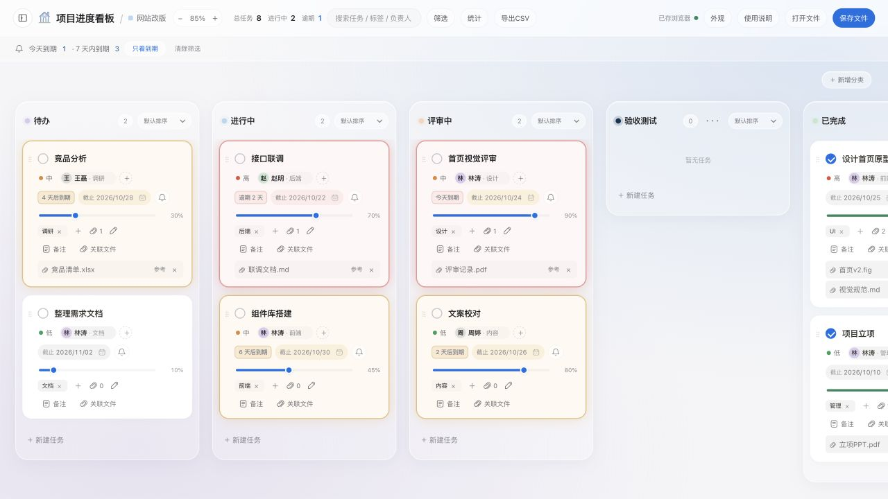

# 项目进度看板 · 个人版

一个保存在自己电脑里的项目看板。打开就能记进度，也能把散落的项目文件关联到任务上，双击文件名直接打开。

**不需要注册账号，不需要服务器，日常使用不联网。**  适合个人工作、学习计划，以及想少填表、多做事的人。



[下载个人版](https://github.com/Tessa0827/project-progress-kanban/releases/latest) · [详细使用指南](使用指南.md) · [提交建议或 Bug](https://github.com/Tessa0827/project-progress-kanban/issues)

## 下载后怎么打开

在 [Releases 下载页](https://github.com/Tessa0827/project-progress-kanban/releases/latest) 的 **Assets** 中，选择自己的版本：

| 你的电脑 | 下载文件 |
| --- | --- |
| Mac · Apple 芯片（M 系列） | `project-progress-kanban-v1.2.0-macos-arm64.zip` |
| Mac · Intel 芯片 | `project-progress-kanban-v1.2.0-macos-x64.zip` |
| Windows 10 / 11 · 64 位 | `project-progress-kanban-v1.2.0-windows-x64.zip` |

**Mac：** 解压，打开文件夹中的「项目进度看板.app」。可以将 app 移到「应用程序」中。Mac 的芯片类型可在苹果菜单 →「关于本机」查看。

**Windows：** 解压整个压缩包，打开文件夹中的 `ProjectProgressKanban.exe`。保留它旁边的所有文件；可以给 exe 创建桌面快捷方式。

`Source code (zip)` 是源码，不是可直接运行的程序。普通使用者下载上表中的文件即可。

## 开始使用

**新建项目 → 添加任务 → 拖动卡片、调整进度 → 自动保存到本机**

1. 左侧点击 **「＋ 新建项目」**，输入名字，选一个喜欢的颜色。
2. 在列底部点击 **「＋ 新建任务」**，填写任务名；负责人、日期、标签和备注按需填写。
3. 拖动卡片换列或排序，拖进度条记录进展，或勾选完成。桌面版顶部显示 **「已存本机」**，代表已保存。

首次打开有内置示例，方便熟悉操作。示例里的项目、人名和文件名用于演示，不是联网获取的资料。

## 可以做什么

- **流程看板：** 默认四列，可新增分类、改名和排序；勾选完成自动移到已完成，取消勾选恢复之前的阶段与进度。
- **项目与任务：** 负责人、优先级、截止日期、标签、备注；支持搜索、筛选、统计和 CSV 导出。
- **本地文件关联：** 在卡片上选择文件，或把文件拖到卡片；双击文件名，用系统默认软件打开。
- **简洁的显示：** 玻璃界面、自定义分类与项目颜色、白色卡片、侧边栏收起／展开、页面缩放；日历和下拉菜单跨系统保持一致。
- **到期提醒：** 提前 1 / 3 / 7 / 14 天用卡片变色和光晕提醒，可关闭；每列可按截止时间正序或倒序排列。
- **完成庆祝：** 任务完成并成功保存后，从卡片边缘撒一分钟彩带，可随时停止。
- **备份和迁移：** 导出 JSON 备份，在另一台电脑或旧网页版本之间手动迁移。

## 文件是怎么管理的

在任务卡片点击 **「关联文件」**，选择文件，文件名就会显示在备注下方。支持一次选择多个文件；也可以从 Finder 或资源管理器拖入。

| 操作 | 结果 |
| --- | --- |
| 双击文件名，或聚焦后按回车 | 用系统默认软件打开原文件 |
| 点击文件夹图标 | 在 Finder／资源管理器中定位文件 |
| 点击文件旁的 × | 解除关联，原文件保留 |
| 原文件搬家后再次打开 | 提示选择对应文件，重新关联 |

**关联只是记住文件位置，不复制文件，也不把文件上传到网站。**  Word、PDF、Excel、图片等格式由电脑上对应的软件打开。长文件名会换行，悬停可以查看全名。当前关联对象为文件，不支持直接关联文件夹。

## 数据放在哪里

桌面版自动把看板数据保存为本机 JSON 文件，无需配置数据库。

| 系统 | 数据目录 |
| --- | --- |
| Mac | `~/Library/Application Support/ProjectProgressKanban/` |
| Windows | `%APPDATA%\ProjectProgressKanban\` |

程序菜单 **「文件 → 打开本机数据文件夹」** 可以定位。主数据文件为 `kanban-data.json`，上一次写入保留为 `kanban-data.previous.json`。

点击顶部 **「保存文件」** 可另存一份 JSON 备份；**「打开文件」**用于导入。备份包含看板内容与文件关联记录，**不包含原文件本身**。换电脑时需另外复制原文件，并在新电脑上重新关联。JSON 中可能包含你填写的备注和本机路径，请自行保管。

个人版不提供账号、云同步或多人协作。不同电脑各自保存进度，更新程序前建议先导出备份。

## 只想用浏览器打开

仓库根目录的 `kanban-personal-optimized.html` 是独立网页，下载后可以直接打开。浏览器版可以管理进度，但数据属于当前浏览器；清除浏览器数据、换浏览器或换文件位置，可能无法读到原内容，建议定期导出 JSON。

**需要双击文件名，用电脑上的软件打开原文件时，请使用桌面版。**  普通网页受浏览器权限限制，不能等同于桌面程序。

## 常见问题

**需要安装 Node.js 或学习编程吗？**  
使用 Releases 中的程序不需要。源码制作才需要对应的开发工具或运行时。

**Mac 提示“无法验证开发者”怎么办？**  
当前版本未做 Apple 公证。确认从本仓库下载后，按 macOS「系统设置 → 隐私与安全性」中的提示处理；如果系统仍阻止或提示文件损坏，请附系统版本到 Issues 反馈。

**Windows 为什么不能只复制一个 exe？**  
exe 需要旁边的运行文件。请保留整个解压目录，使用快捷方式启动。

**已经在旧网页里记了内容，如何搬过来？**  
旧网页点击「保存文件」导出 JSON，桌面版点击「打开文件」导入。浏览器里的数据不会自动进入桌面程序。

**打开后内容不见了？**  
先确认是不是换了个人版／浏览器版、浏览器或电脑。已有备份可用「打开文件」导入；桌面版还可在数据目录查看 `kanban-data.previous.json`。先保留现有数据文件，再进行恢复。

## 反馈问题

请在 [Issues](https://github.com/Tessa0827/project-progress-kanban/issues) 提交：你使用的系统、程序版本、操作步骤，以及预期结果和实际结果。截图能更快说明问题；提交前请遮住项目内容、路径和其他隐私。

## 开发与自行制作

这是 HTML / CSS / JavaScript + Electron 的本地桌面应用。下载程序已包含 Electron，无需另行安装。

```text
app/                           桌面程序与内嵌看板
scripts/                       Mac / Windows 制作脚本
tests/                         数据、文件关联及界面逻辑检查
kanban-personal-optimized.html  可单独打开的网页版本
```

运行现有自动检查（需要 Node.js）：

```sh
npm test
```

从源码启动（首次下载运行时需要联网）：

```sh
npx --yes electron@45.0.0 .
```

Mac 在源码目录运行 `bash scripts/build-mac.sh`；Windows 双击 `制作Windows版.cmd`。制作脚本会下载 Electron 官方最新稳定运行时并校验 SHA-256，再生成对应平台的程序。脚本制作版本所用运行时可能与 Releases 不同。

## 当前版本

**1.2.0，测试发布。**  当前下载包使用 Electron 45.0.0；Mac 包已通过本地签名与完整性检查，但未使用商业签名证书或做 Apple 公证。Windows 包已校验结构和官方运行时哈希，尚未在 Windows 实机验收。发布附件中的 `SHA256SUMS.txt` 可用于核对下载完整性。

本仓库仅包含个人版，不包含企业版、腾讯云配置或任何使用者的实际项目数据。运行时及其第三方组件保留各自许可；项目尚未另行指定开源许可证。
